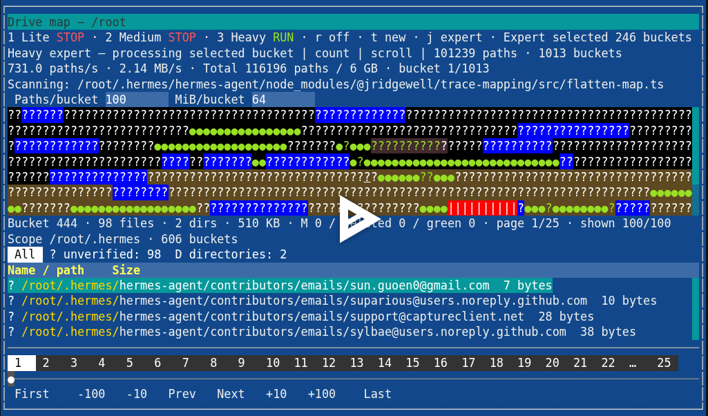
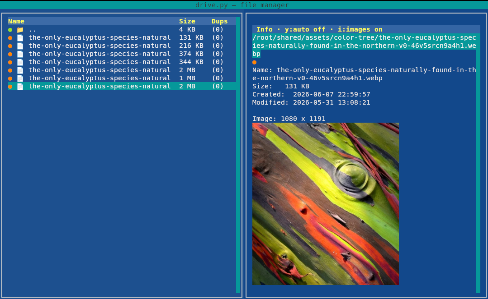
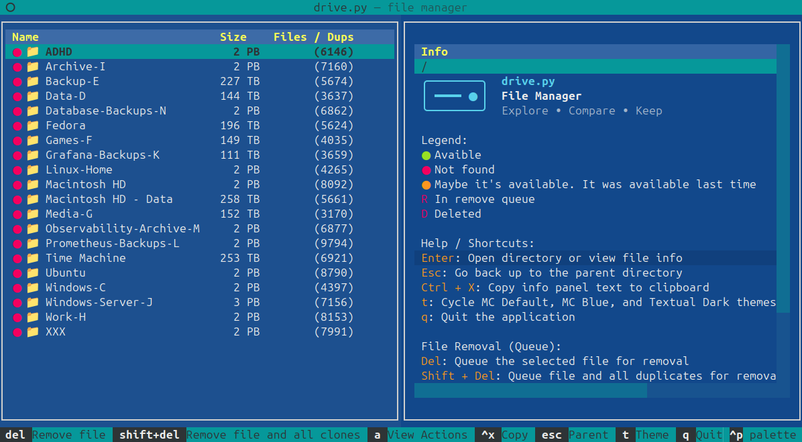
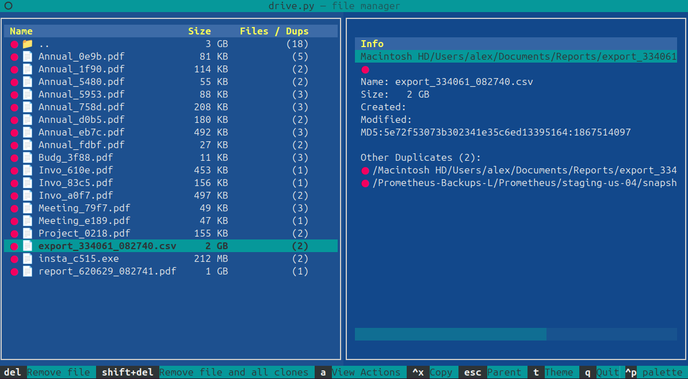
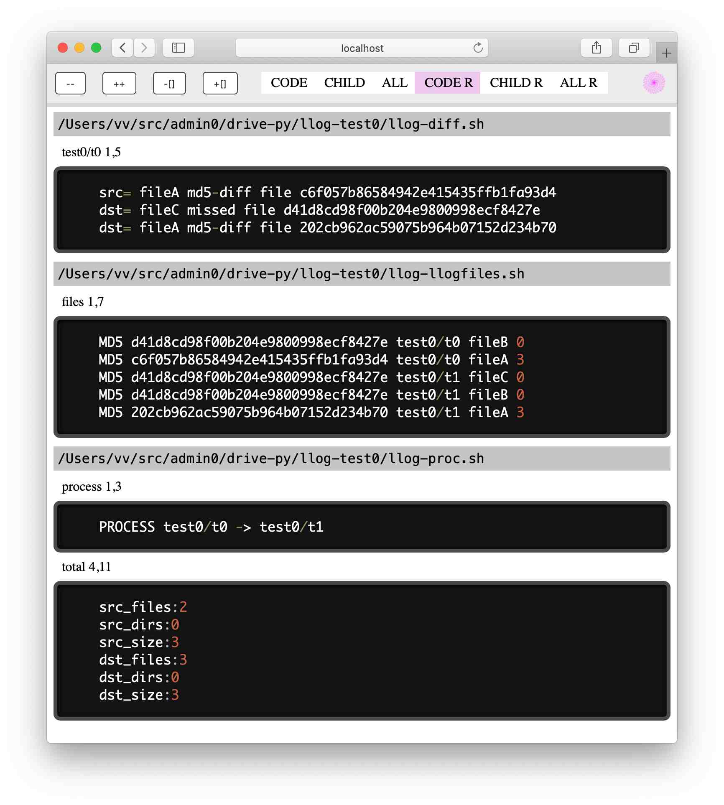

# drive.py

drive.py v0.997 - background scanning, scan statistics, video conversion, faster history, filename navigation and bookmark previews

Multithreaded disk file comparison tool for verification and MD5 checksum reporting.

- **drive.py** — CLI disk analyzer.
- **drive-tui.py** — prompt_toolkit TUI for browsing the disk database and live drive maps.

[](https://asciinema.org/a/cU8hD5HZ4d9o7DsJ)







## Prerequisites
- Python 3.10 or newer
- uv (runs the prompt_toolkit TUI)
- Node.js (required for the web viewer)

## Run drive-tui.py

From the project directory, run `./run.sh` to open the terminal file browser.
The launcher uses uv to install dependencies and starts with a SQLite catalog.
Pass a directory to browse or `-d` to load scan logs:

```bash
./drive-tui.py ~
./drive-tui.py ~/mypath
./run.sh
./run.sh /path/to/browse
./run.sh -d /path/to/logs
```

See [Help](help.md) for more options and keyboard controls.

## Run drive.py

```bash
usage: drive.py [-h] [-s SRC] [-d DST] [-f FILE] [-e EXCLUDE] [-n NOTREE] [-t THREADS] logdir

Compare directories. Usage examples:
  drive.py -s <src>.. <logdir> # scan dirs only
  drive.py -s <src>.. -d <dst>.. <logdir> # compare dirs
  drive.py -f <log>.. -e <dir>.. <logdir> # compare logs

positional arguments:
  logdir                Log directory path

options:
  -h, --help            show this help message and exit
  -s SRC, --src SRC     Source directory path
  -d DST, --dst DST     Destination directory path
  -f FILE, --file FILE  Log file path
  -e EXCLUDE, --exclude EXCLUDE
                        Exclude dir for scanning (with -f)
  -n NOTREE, --notree NOTREE
                        No files tree
  -t THREADS, --threads THREADS
                        Number of threads for file hashing
```

## Run demo: Build demo report

Just try this demo:
```bash
./drive.py -s test0/t0 -d test0/t1 log-test0
```

## Megadisks demo

Browse synthetic disks, files, and backup duplicates in the TUI:

```bash
./run-megadisks.sh
```

Requires uv and generated `log-megadisks/` data.

## Navigate source with LiveComment

Python, shell and archived CSS source includes descriptive LiveComment blocks,
including tests and the archived Textual UI. With LiveComment installed, run
`livecomment --path .` from the repository root to navigate the source, or pass
an individual source file. See [coverage and validation](FEATURE-livecomment.md).

## Run demo: View demo log files in your browser 

1. Install LiveComment
```bash
npm i -g livecomment
```
2. Start LiveComment web server
```bash
livecomment --path log-test0
```
3. Open http://localhost:3070/
```bash
open http://localhost:3070/
```



### Dump log files to shell
```bash
$ cd log-test0/

# Differences log llog-diff.sh

$ cat llog-diff.sh 

# test0/t0 [
src= fileA md5-diff file c6f057b86584942e415435ffb1fa93d4
dst= fileC missed file d41d8cd98f00b204e9800998ecf8427e
dst= fileA md5-diff file 202cb962ac59075b964b07152d234b70
# test0/t0 ]

# All files llog-llogfiles.sh

$ cat llog-llogfiles.sh 

# files [
MD5 d41d8cd98f00b204e9800998ecf8427e test0/t0 fileB 0
MD5 c6f057b86584942e415435ffb1fa93d4 test0/t0 fileA 3
MD5 d41d8cd98f00b204e9800998ecf8427e test0/t1 fileC 0
MD5 d41d8cd98f00b204e9800998ecf8427e test0/t1 fileB 0
MD5 202cb962ac59075b964b07152d234b70 test0/t1 fileA 3
# files ]

# Resume llog-proc.sh 

$ cat llog-proc.sh 

# process [
PROCESS test0/t0 -> test0/t1
# process ]
# total [
src_files:2
src_dirs:0
src_size:3
dst_files:3
dst_dirs:0
dst_size:3
# total ]
```

## Tests

Run the regression suite with:

```sh
.venv/bin/python -m unittest discover -s tests -v
```

Redis tests require the Python `redis` package and `redis-server` on `PATH`
(or an executable path in `REDIS_SERVER`). They start and stop a private server
using a temporary Unix socket with persistence disabled. If either dependency
is missing, Redis tests are skipped. To run only Redis tests:

```sh
.venv/bin/python -m unittest discover -s tests -p 'test_redis.py' -v
```

Redis coverage reuses SQLite navigation assertions and compares node metadata,
directory sizes, and duplicate indexes with SQLite. It also checks reopening
and empty trees. Incremental updates remain SQLite-only.

## TODO

- TODO: files: Page up/down keys navigation (DataTable)
- TODO: actionsview: Delete key - remove from actlions list
- TODO: actionsview: highlight dir
- TODO: Shift-Delete: Select files to remove (DataTable, space select, multiple options)
- TODO: Config: -c config.sh arg 
- TODO: Config: config.sh section DB=mysql and LLOGSEARCHPATH=../llogd/:../llogd1/

## FAQ

### Why is the config in Livecomment format instead of JSON?

> Why is the config in Livecomment format instead of JSON?

Livecomment is an extensible format that can store multiple types of data. It supports both traditional Linux-style configuration formats (such as `fstab`-style mappings and plain text) as well as structured data like JSON, allowing different configuration styles to coexist in a single format.

## Keys

See [Help](help.md) for keys, navigation and detailed controls.

## Version History

See [Version History](VERSION-HISTORY.md).

## License
MIT

## Author
Github [@web3cryptowallet](https://github.com/web3cryptowallet)

Twitter [@web3wallet](https://twitter.com/web3wallet)

## Contribute
Just add an issue and push pull request

## Contact

[web3future@protonmail.com](mailto:web3future@protonmail.com)

## Sponsorship

If you appreciate this project, please star it on GitHub and/or sponsor on GitHub or donate crypto below.

Looking for sponsors to help fund development.

BTC 💰
18Bth1u3pSJzPrCf21tx1F6iSzA2fgKdfU

SOL Solana 💰
9gLVQr97baX3KrG9DyaUDd5FwXaiLcDuU6CK5RCNMnWu

ETH Ethereum 💰
0x072c709a8Ad95Fc182e0E2EEF834C3d944122f0b

USDT Ethereum 💰
0x072c709a8Ad95Fc182e0E2EEF834C3d944122f0b

DOGE Dogecoin 💰
DJP8425i4sGT4tSEXwEDRPJb4vJBGroJs6

LTC Litecoin 💰
ltc1q69gg9udgqnky60n7mfzfaj0w7lu80ujx6fysly

TRX Tron 💰
TLjkoQfnu7aRRbVRkEYN1vZPzW7ntuM4tn


## License

[MIT](https://github.com/web3cryptowallet/drive-py/blob/main/LICENSE)


<a href="https://www.star-history.com/?repos=web3cryptowallet%2Fdrive-py&type=date&legend=top-left">
 <picture>
   <source media="(prefers-color-scheme: dark)" srcset="https://api.star-history.com/chart?repos=web3cryptowallet/drive-py&type=date&theme=dark&legend=top-left" />
   <source media="(prefers-color-scheme: light)" srcset="https://api.star-history.com/chart?repos=web3cryptowallet/drive-py&type=date&legend=top-left" />
   
 </picture>
</a>

## Recomended projects

- [livecomment](https://github.com/d08ble/livecomment) project
- [bitchatX21](https://github.com/goldenwebb/bitchatX21) a better version of Bitchat for iOS

*AI-Independet code. Created through human work*


