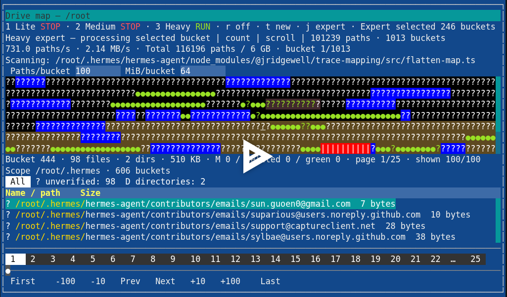
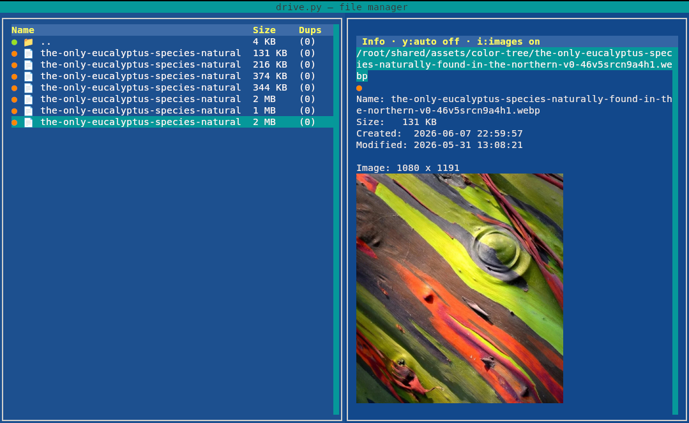
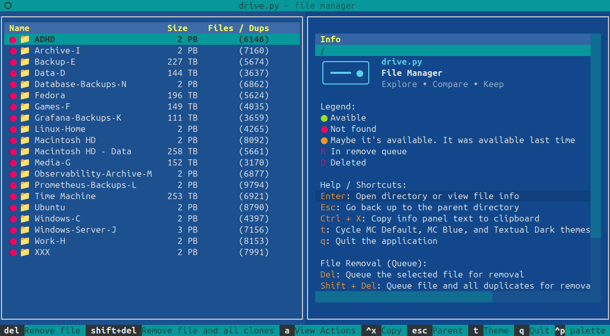
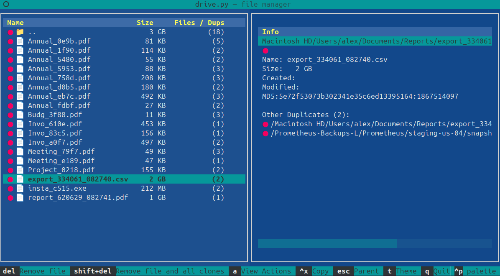
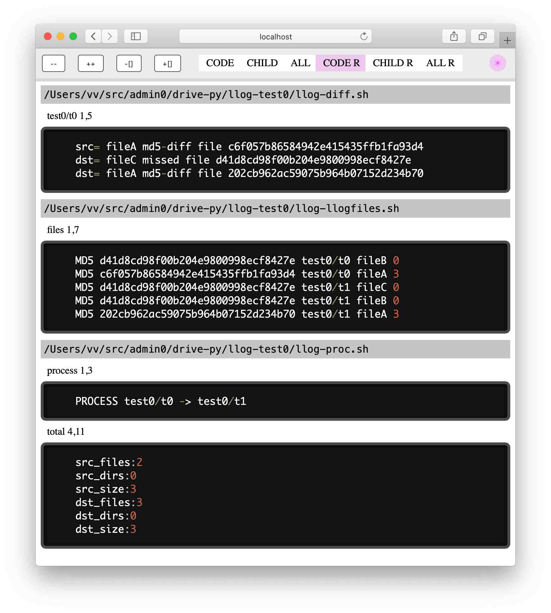

# drive.py

drive.py v0.996

- FILENAMES: `Shift+Left/Right` pans long names; `Shift+Home/End` and `Shift+PageUp/PageDown` both reveal the beginning/end. Click or drag rectangular horizontal scrollbars across file lists. Limits use the longest name/row plus a trailing space that retains selection highlighting; main Size/Dups stay fixed.
- BOOKMARKS: Use equal-width list/preview panes. Green/red circles show mapped filesystem target presence, including configured aliases; missing bookmarks remain editable/removable.
v0.996 - page-priority previews, filename scrolling, bookmarks, path history and desktop integration

Multithreaded disk file comparison tool for verification and MD5 checksum reporting.

- **drive.py** — CLI disk analyzer.
- **drive-tui.py** — prompt_toolkit TUI for browsing the disk database and live drive maps.

[](https://asciinema.org/a/cU8hD5HZ4d9o7DsJ)







## Prerequisites
- Python 3.10 or newer
- uv (runs the prompt_toolkit TUI)
- Node.js (required for the web viewer)

## Usage
```bash
usage: drive.py [-h] [-s SRC] [-d DST] [-f FILE] [-e EXCLUDE] [-n NOTREE] [-t THREADS] logdir

Compare directories. Usage examples:
  drive.py -s <src>.. <logdir> # scan dirs only
  drive.py -s <src>.. -d <dst>.. <logdir> # compare dirs
  drive.py -f <log>.. -e <dir>.. <logdir> # compare logs

positional arguments:
  logdir                Log directory path

options:
  -h, --help            show this help message and exit
  -s SRC, --src SRC     Source directory path
  -d DST, --dst DST     Destination directory path
  -f FILE, --file FILE  Log file path
  -e EXCLUDE, --exclude EXCLUDE
                        Exclude dir for scanning (with -f)
  -n NOTREE, --notree NOTREE
                        No files tree
  -t THREADS, --threads THREADS
                        Number of threads for file hashing
```

## Run demo: Build demo report

Just try this demo:
```bash
./drive.py -s test0/t0 -d test0/t1 log-test0
```

## Megadisks demo

Browse synthetic disks, files, and backup duplicates in the TUI:

```bash
./run-megadisks.sh
```

Requires uv and generated `log-megadisks/` data.

## Main TUI (prompt_toolkit)

Startup directories and configured mount roots may be symlinks; their resolved
targets are used to match catalog drive aliases.

All screens highlight program-generated numbers in gold (`40` in `40 MB`,
`1.25` in `1.25 GiB/s`); units keep their normal colors. Complete hashes are gold. Numbers in filenames and paths
keep their normal colors. See [number highlighting](FEATURE-number-highlighting.md).

```bash
./run.sh -d /path/to/logs
./run.sh -c sqlite
```

Activates the project `.venv` (creating it with `uv sync` if needed), then uses
`uv` to run `drive-tui.py` from the project directory, forwarding arguments.
`run.sh` defaults to SQLite; use `-c memory` for an in-memory catalog.
A missing or empty `drivevfs` initializes an empty catalog and opens the local
startup directory without requiring a log import (see [first-start fix](FEATURE-sqlite-first-start.md)).
Use `./run-megadisks.sh` for the generated megadisks dataset.
Terminal colors follow detected capabilities: Apple Terminal uses 256 colors;
terminals advertising RGB use true color. To force 256 colors, run
`PROMPT_TOOLKIT_COLOR_DEPTH=DEPTH_8_BIT ./run.sh`. See
[terminal color compatibility](FEATURE-terminal-colors.md).

Startup and updates do not run legacy source-path migration. To convert an old
catalog explicitly, run from the project directory:

```bash
uv run migrate-paths.py                  # existing drivevfs and registered fragments
uv run migrate-paths.py /path/to/catalog --config /path/to/config.sh --batch-size 100
```

The command uses drive mappings from `config.sh` (if present), preserves backups
as `<database>.source-paths-backup.sqlite`, and refuses ambiguous path collisions
or overwriting an existing backup. It reports the number of changed file records.
Migration stages its plans in temporary SQLite files and processes 500 rows per
batch by default. Use `--batch-size 100` for smaller batches at the cost of speed.
Temporary disk space scales with catalog size; staging caches are capped at about
1 MiB per database. Batches remain in one transaction for rollback safety, so the
writer lock lasts through migration. New catalogs need no migration.

Split SQLite storage by catalog path using `db_fragments` in the `SETTINGS JSON`
section of `config.sh`:

```json
{"db": "sqlite", "db_fragments": {"/1T": "fragments/1T.sqlite", "/1T/photos": "fragments/photos.sqlite"}}
```

```bash
./run.sh -refragment
./run.sh -export-livelog /tmp/catalog-export
```

`-refragment` explicitly activates new paths. Existing files move lazily when their
directory is browsed or written, in bounded transactions without rescanning or
rehashing. Nested paths use the most specific prefix; all databases remain visible
during migration. Active mappings persist even if removed from config. Relative
filenames resolve from the launch directory; prefixes use catalog drive aliases.
Keep the main database and all fragments together for backup. Migration does not
automatically shrink the original SQLite file.

`-export-livelog DIR` exports to a new/empty directory and exits. It writes a
`db-paths.json` manifest, one importable `llog-llogfiles.sh` per database, raw node/hash
JSONL files and a coordinator SQL dump. Import checksum logs with
`./run.sh -u -d /tmp/catalog-export`; this does not restore raw metadata automatically.
See [path fragments](FEATURE-path-fragments.md) for storage and recovery details.

Pass an optional startup directory, including `~`, relative paths or paths with spaces:

```bash
./drive-tui.py ~
./drive-tui.py ~/mypath
./run.sh ~/mypath
./run.sh "/path/with spaces"
```

Direct execution requires prompt_toolkit, term-image and Pillow in the Python environment (for example,
activate `.venv` first); `run.sh` manages dependencies through uv. Without a path,
the browser starts in the process's current directory. The positional path changes
only the browsing location; config, log discovery and SQLite cache resolution
remain in the launch working directory. `run.sh` first changes to the project
directory. Configured local drive mounts translate to VFS aliases. Invalid or
non-directory paths produce a command-line error. `-d` selects log input.

Filename scrolling works in the main table, graphics labels, Bookmarks, Actions,
scanner details, action history and path-command lists:

| Shortcut | Action |
| --- | --- |
| **Shift+Left / Shift+Right** | Move the filename viewport one symbol |
| **Shift+Home / Shift+End** | Reveal the beginning / end |
| **Shift+PageUp / Shift+PageDown** | Same beginning / end actions |

Click or drag the horizontal scrollbar's rectangular thumb to pan. It uses the
same track/thumb colors as the vertical scrollbar. The scroll limit follows the
longest displayed name/row, regardless of selection, with one trailing space.
That space keeps the selected row's background. Main status/bookmark markers and
Size/Dups columns stay fixed. In read-only Info/help, these shortcuts move the
text cursor within the logical line. See [filename navigation](FEATURE-filename-pan.md).

Press **j** for Bookmarks: the list and shared quick-view preview each use half
the width. Each path has a **green ●** when its mapped local target exists or a
**red ●** when offline/missing; configured aliases are resolved before checking.
Arrows or clicks select and preview; **Enter** opens the target. **e** edits its
path; **Delete** removes it. Bookmarks and selection persist in `.bookmarks.json`.
See [bookmark controls and previews](FEATURE-bookmarks.md).

In file lists, **x** off shows filenames and relative expanded subdirectory paths;
**x** on shows prefixed full paths in the Path column and graphics labels.
Press **x** to switch path labels across views between prefixed paths and original
absolute filesystem paths. Prefixes are `~:` for the launch working directory,
`<drive-id>:/` for configured drives, and `:/` for global paths. The preference is
session-only; bookmarks and scan identities retain their stored format. In bookmark
path/number editors, x types normally. Actions: **Ctrl+Delete** or **Clear** clears
the queue. See [path prefix details](FEATURE-path-prefixes.md).

In the main view, **Backspace** or **Esc** goes to the parent directory and
restores the child selection, including when the info pane has focus.
Press **Ctrl+O** to open the selected file with its default desktop application,
or a directory in the default file manager (Finder / Ubuntu Files, etc.).
In Info, a selected duplicate opens instead; otherwise the file-list selection
is used. Linux requires `xdg-open` and a configured desktop session.
Use **Ctrl+Y** to copy the selected absolute local path, **Ctrl+T** to open a
new terminal, and **Ctrl+F** to open the default file
manager and highlight the selected file (Finder on macOS, Files on Ubuntu).
Directories open normally; Terminal uses the selected folder or a file's parent.
Linux selection uses FileManager1 D-Bus or supported manager selection commands;
the generic fallback opens the parent without highlighting.
Linux needs an installed terminal emulator (x-terminal-emulator, gnome-terminal,
konsole, xfce4-terminal or xterm). Clipboard uses pbcopy on macOS, wl-copy/xclip/xsel on Linux, PowerShell on
Windows/WSL, or a built-in X11/XWayland owner (python-xlib) when Linux utilities
are missing. Terminal OSC 52 is the final fallback; Ubuntu Terminal may ignore it.


Mark folders for scanning with **Space** (toggle without moving) or **Insert**
(toggle and move down). **\*** inverts marks on all listed folders; **-** clears
all marks. Marked folder names are gold, including under the cursor. **s** scans
marked folders, or the current directory when none are marked. Entering another
directory clears marks. Files and `..` cannot be marked. Marks are session-only;
scoped maps/resume positions are saved separately for each folder set.
Thumbnail height uses **+** / **_** (Shift+-).

Press **q** from any view (including help, Actions and scanner inputs) to quit
the app. Scanner shutdown retains the existing cancellation and save behavior.

In the PT main view, **Shift+R** clears the saved map and resume positions for the
current directory. Other folders, file records and checksums are retained.

The prompt_toolkit implementation is now the main `drive-tui.py`. Shared VFS,
scanner and database code remains in `vfs/`. Run active tests with
`uv run python -m unittest discover -s tests -v`.


## Navigate source with LiveComment

Python, shell and archived CSS source includes descriptive LiveComment blocks,
including tests and the archived Textual UI. With LiveComment installed, run
`livecomment --path .` from the repository root to navigate the source, or pass
an individual source file. See [coverage and validation](FEATURE-livecomment.md).

## Run demo: View demo log files in your browser 

1. Install LiveComment
```bash
npm i -g livecomment
```
2. Start LiveComment web server
```bash
livecomment --path log-test0
```
3. Open http://localhost:3070/
```bash
open http://localhost:3070/
```



### Dump log files to shell
```bash
$ cd log-test0/

# Differences log llog-diff.sh

$ cat llog-diff.sh 

# test0/t0 [
src= fileA md5-diff file c6f057b86584942e415435ffb1fa93d4
dst= fileC missed file d41d8cd98f00b204e9800998ecf8427e
dst= fileA md5-diff file 202cb962ac59075b964b07152d234b70
# test0/t0 ]

# All files llog-llogfiles.sh

$ cat llog-llogfiles.sh 

# files [
MD5 d41d8cd98f00b204e9800998ecf8427e test0/t0 fileB 0
MD5 c6f057b86584942e415435ffb1fa93d4 test0/t0 fileA 3
MD5 d41d8cd98f00b204e9800998ecf8427e test0/t1 fileC 0
MD5 d41d8cd98f00b204e9800998ecf8427e test0/t1 fileB 0
MD5 202cb962ac59075b964b07152d234b70 test0/t1 fileA 3
# files ]

# Resume llog-proc.sh 

$ cat llog-proc.sh 

# process [
PROCESS test0/t0 -> test0/t1
# process ]
# total [
src_files:2
src_dirs:0
src_size:3
dst_files:3
dst_dirs:0
dst_size:3
# total ]
```

## Tests

Run the regression suite with:

```sh
.venv/bin/python -m unittest discover -s tests -v
```

Redis tests require the Python `redis` package and `redis-server` on `PATH`
(or an executable path in `REDIS_SERVER`). They start and stop a private server
using a temporary Unix socket with persistence disabled. If either dependency
is missing, Redis tests are skipped. To run only Redis tests:

```sh
.venv/bin/python -m unittest discover -s tests -p 'test_redis.py' -v
```

Redis coverage reuses SQLite navigation assertions and compares node metadata,
directory sizes, and duplicate indexes with SQLite. It also checks reopening
and empty trees. Incremental updates remain SQLite-only.

## TODO

- TODO: files: Page up/down keys navigation (DataTable)
- TODO: actionsview: Delete key - remove from actlions list
- TODO: actionsview: highlight dir
- TODO: Shift-Delete: Select files to remove (DataTable, space select, multiple options)
- TODO: Config: -c config.sh arg 
- TODO: Config: config.sh section DB=mysql and LLOGSEARCHPATH=../llogd/:../llogd1/

## FAQ

### Why is the config in Livecomment format instead of JSON?

> Why is the config in Livecomment format instead of JSON?

Livecomment is an extensible format that can store multiple types of data. It supports both traditional Linux-style configuration formats (such as `fstab`-style mappings and plain text) as well as structured data like JSON, allowing different configuration styles to coexist in a single format.

## License
MIT

## Author
Github [@web3cryptowallet](https://github.com/web3cryptowallet)

Twitter [@web3wallet](https://twitter.com/web3wallet)

## Contribute
Just add an issue and push pull request

## Contact

[web3future@protonmail.com](mailto:web3future@protonmail.com)

## Sponsorship

If you appreciate this project, please star it on GitHub and/or sponsor on GitHub or donate crypto below.

Looking for sponsors to help fund development.

BTC 💰
18Bth1u3pSJzPrCf21tx1F6iSzA2fgKdfU

SOL Solana 💰
9gLVQr97baX3KrG9DyaUDd5FwXaiLcDuU6CK5RCNMnWu

ETH Ethereum 💰
0x072c709a8Ad95Fc182e0E2EEF834C3d944122f0b

USDT Ethereum 💰
0x072c709a8Ad95Fc182e0E2EEF834C3d944122f0b

DOGE Dogecoin 💰
DJP8425i4sGT4tSEXwEDRPJb4vJBGroJs6

LTC Litecoin 💰
ltc1q69gg9udgqnky60n7mfzfaj0w7lu80ujx6fysly

TRX Tron 💰
TLjkoQfnu7aRRbVRkEYN1vZPzW7ntuM4tn


## License

[MIT](https://github.com/web3cryptowallet/drive-py/blob/main/LICENSE)

Action history: press `l` in the main file manager to view saved navigation,
file/image views, playback start/latest positions, desktop-open requests and
queued removals. Stored locally in `history.llog`, with image views in their own
LiveLog subnode. In history, `Delete` removes one record, `Shift+Delete` clears
all records, and `Enter` goes to the directory when available in the catalog.
Green ● / red ○ show mapped local presence; `t` alternates online/offline history
filters (initially both). Main-screen `t` continues to change themes.

File lists start with ordinary names (no colon prefixes); x enables prefixed
paths. Local path resolution accepts `:/absolute/path` and configured
`alias:/path` prefixes. Relative paths such as `test0/` resolve from the launch
working directory; absolute `/home/...` paths remain rooted at `/`. A file-list
`↗` suffix marks a symlink without changing its name or stored identity. Its
circle is green when the target exists and red for a broken link.

Catalog source paths are stored as `test0/a` for relative paths and `/home/...`
for absolute paths in file metadata, duplicate indexes and LiveLog exports.
VFS decodes relative paths against each run's launch working directory; `~:test0`
is a virtual/display namespace, not a stored source-path prefix. Absolute paths
stay rooted at `/`, with configured drive mappings applied. Internal tree IDs
remain separate indexing keys. Run `uv run migrate-paths.py [database]` explicitly
to upgrade earlier prefixed source fields; startup does not migrate them. Each
changed database gets a `.source-paths-backup.sqlite` snapshot; earlier
`.paths-backup.sqlite` snapshots remain intact. See
[path storage and VFS decoding](FEATURE-path-prefixes.md).

## Path navigation and history

Press **~** on the main screen to open your home directory. Press **/** to open
the path window with `/` already entered and its children listed immediately.
Typing a directory such as `/home/` automatically lists its children, directories
first. Press `~` while the input is `/` to fill your home directory and list it;
Enter opens it.

- **↑/↓** select a path suggestion; **Tab** fills it into the input. Selecting a
  directory lists its children automatically. Clicking a suggestion also fills it.
- **Enter** opens the entered directory or selects the entered file in its parent.
  **Esc** closes the window without navigating.
- **Ctrl+U** clears the input to enter a replacement path or `cd PATH`. An empty
  Enter goes to `/`. Relative paths resolve from the browsed directory; `~:`
  retains its launch-relative meaning. Shortcut letters type normally here.
- **Ctrl+R** focuses the visible **Path history** pane. Use arrows and Enter to
  reopen a target, or click one to load it into the input. Successful targets,
  including selected files, appear newest first without duplicate rows. Invalid
  and cancelled paths are excluded. History persists in `history.llog`.

See [path-command details](FEATURE-path-command.md) for behavior and limitations.

## Recent graphics and desktop controls


### Filters, appearance and Quick View

| Control | Action |
| --- | --- |
| `v` | Cycle all → media → image → videos; show the selected filter in a three-second popup |
| `t` | Cycle MC Default → MC Blue → Textual Dark → White (white background, dark text) |
| Quick View `B` | Click in `● B filename` to toggle the previewed item's bookmark; gray is off, cyan is on |

Media includes images, videos and audio. Filtered directories must contain matching
descendants, except explicitly blacklisted directories, which remain visible.
Gold highlighting applies to standalone numeric values; words such as `mp3` and
`h264` keep their normal color. Complete hash records retain gold styling.

### Directory blacklist for u expansion

| Control | Action |
| --- | --- |
| `!` in Files | Add/remove the selected directory's exclusion; files and `..` are ignored |
| `X` | Enable or bypass all saved exclusions |
| `L` | Open the selectable blacklist |
| Enter in blacklist | Open the selected directory |
| Delete in blacklist | Remove the selected exclusion and save immediately; files are untouched |
| Esc in blacklist | Close the view |

Directory rows show `!` after bookmark `B`, when present. Red means exclusions are
active; green means bypassed. `u` skips each excluded directory's entire subtree.
Enabling exclusions collapses excluded expansions and cancels pending discovery.
After bypassing, press `u` to expand again. Unavailable blacklist entries remain
removable; Enter leaves the view open if the directory cannot be resolved.

Saved paths live in `.blacklist.json` in the app's working directory. The bypass
switch is session-only and restarts enabled. Manual navigation and live scanner
`s` are unaffected. See [u blacklist](FEATURE-u-blacklist.md).

### Loading feedback and large listings

Folder changes and `u` expansion show a Working popup until processing finishes.
Folder disk checks currently remain synchronous, so the popup does not imply
that navigation is nonblocking.

Graphics redraws reuse filename measurements, display labels and preview-map
indexes; thumbnail visibility checks visit viewport grid rows. Initial disk
listing, cold filename measurements, recursive qualification and image decoding
still take time, especially on external disks. The regression in
[tests/test_grid_large_directory.py](tests/test_grid_large_directory.py) creates
10,000 files and checks warm redraws and viewport-bounded visibility lookup; it
does not establish fast initial loading or image decoding.

Player controls include **<Prev** and **Next>** to move between audio/video files
in list order (bookmark order inside Bookmarks). Playback continues when active;
otherwise the target is previewed. Double-click a file in the main table/grid to
select and preview it; audio/video starts when playback is already active.

### Graphics, expansion and desktop actions

Graphics mode (`g`): press `G` (Shift+g) with Files focused to cycle thumbnail
creation order: sequence, random, page-diagonal stride, whole-range stride.
Every mode completes the current visible page first, starting at its first
pending image after a page change, then processes the remaining listing. Stride
advances one column and row at a time. Page-stride finishes the priority page,
then strides across the entire remaining range instead of completing each
offscreen page in turn. Completed thumbnails remain visible when
changing order. A fixed-height color map on the
right shows thumbnail coverage across the listing, one cell per grid column.

Press `u` again while a directory expansion is pending to cancel it and retain
the previous listing. Slow OS reads may finish in the background; cancelled rows
are discarded. Click the graphics preview map to select the represented file
and scroll to its page. Map columns match the current image grid after resizing.

During `u` expansion, the file header shows `u: scanning N files (u:cancel)` in
both table and graphics mode. The count updates after directory reads and counts
each discovered file once; it clears when expansion finishes or is cancelled.

`u` reuses directory discovery within each expansion and skips a second metadata
or duplicate-query pass. Its progress updates in batches of 1,000 discovered files
(start and finish still update immediately). New file duplicate counts are filled
by an ordinary refresh.

Expansion scheduling uses a shorter worker-completion poll and processes rows in
1,000-entry batches. A local 100-file/101-directory fixture improved from 2.02s to
0.30s; actual storage and OS scheduling affect discovery speed.

In filtered modes (`v`: all / media / image / videos), directories without matching descendants are
hidden, respecting dotfile visibility; explicitly blacklisted directories remain visible. The graphics map leaves missing file cells
blank, marks selection with `◆`, and supports left-button dragging to select
files and scroll the file pane.

Graphics mode hides directories without image/video descendants, retaining explicitly blacklisted directories and `..`
for navigation. Map clicks/dragging align the image tile above its filename.
Existing JPEG thumbnails load from disk cache before missing previews on the
current page are generated. With Files focused in graphics mode, `k` clears
thumbnail caches for the current directory subtree; `K` (Shift+k) clears all
thumbnail caches. Previews regenerate automatically. These keys clear generated
JPEGs and thumbnail links, retaining original media files.

Thumbnail names: `128x128-<source-bytes>-<first-1-MiB-SHA256>-<identity>.jpg`
(or 256x256). Images and videos use the same bounded prefix hash. A matching saved
source fingerprint reuses that hash without rereading the original; changed or
unrecognized sources are hashed again. Up to 128 prepared terminal previews stay
in memory for repeat visits. `k`/`K` also clear this prepared cache. Existing
old-name JPEGs regenerate on demand. A warm local repeated-preparation benchmark
improved from 1.79 to 0.22 ms/image; UI/terminal rendering time is separate.

Clipboard shortcuts: `Ctrl+X` copies Info text, including with Info focused;
`Ctrl+Y` copies the selected absolute path. Desktop clipboard tools
have bounded timeouts and fall back to OSC 52. SSH uses the terminal clipboard;
OSC 52 requires terminal clipboard permission/support. Under tmux, normal OSC 52
and passthrough framing are sent; tmux clipboard/passthrough settings still apply.

In graphics mode, `-` (or `_`) shrinks preview height and `+`/`=` enlarges it.
Table-mode `-` retains scan-selection clearing. Arrow navigation keeps selected
image rows above their filename visible. HEIC/HEIF/HIF previews use pillow-heif
(installed by `uv sync`); `.web` is supported as an image alias. WebP/WebM and
MTS/M2TS remain supported; video frames require system FFmpeg.

Completed G-mode preview filenames match the displayed image width and horizontal
alignment. Long names clip from the left; bookmark markers fit inside that width.

Small G-mode previews use their actual icon width, with one column between tiles
and no fixed side borders. At 1–3 lines, reducing zoom fits more images per row;
the right-side preview map follows the new column count.

Ubuntu clipboard: `Ctrl+Y` can copy through X11/XWayland without
installing xclip or wl-copy. Run `uv sync` after updating to install python-xlib.
A native clipboard owner serves paste requests while the app runs; clipboard
persistence after exit depends on a desktop clipboard manager. Pure Wayland
without XWayland still needs `wl-copy` (package `wl-clipboard`). OSC 52 fallback
now writes directly without a full-screen blink.

Copy actions show “Copied to clipboard” in a floating popup for three
seconds after native success. Terminal OSC 52 fallback shows “Clipboard request
sent” because delivery cannot be confirmed. Repeated copies renew the notice.

Reveal also requests foreground activation: explicitly activates existing Finder
on macOS and requests the matching existing file-manager window on X11. Linux
startup IDs are forwarded. Desktop focus policy and Wayland-native windows can
prevent raising; selection/reveal still works when foreground activation is refused.

`Shift+G` preview-order changes also show `Preview order: <mode>` in a floating
popup for three seconds. Notifications do not reserve a bottom row.

## Copy a directory without ignored files

```bash
./copy-dir.sh /path/to/source /path/to/destination
./copy-dir.sh /path/to/source /path/to/destination -m  # Open Meld after copying
```

The shell script uses **Bash, rsync and realpath**. It reads root/nested
`.gitignore` files as rsync exclusion lists, excludes `.git` and `files_dst.copy`,
creates the destination and any missing parents, and copies source contents
without deleting unrelated files.
The project ignore list also excludes the archived `texual.removed/` directory.
A dry run first writes planned transfer paths to `files_dst.copy` in your current
directory, then rsync performs the copy. Source and destination must not overlap.
Rsync patterns do not support full Git ignore semantics, including `!` negation.
Add `-m` before or after the paths to open Meld comparing source and destination
after a successful copy (requires Meld installed).
See [directory copy details](FEATURE-copy-directory.md).

To package the project, run `bash pack.sh` from the project directory (requires
`~/shared` to exist). It writes `~/shared/drive-py.tgz`, excluding `.cache`
directories, `.venv`, archived `texual.removed`, `drivevfs*` and `.bookmarks.json`.
See [packaging details](FEATURE-pack-directory.md).

## Version History

v0.91
 - added actions generation
 
v0.92
 - added a file indicator to the file list

v0.93
 - info: show dir status - n files

v0.94
 - info: show dir status - n files

v0.95
- BUGFIX: Shift+Del: Remove directories recursively
- TODO: ActionsView: Show the file status in the list
- BUGFIX: ActionsView: Wrong file is removed

v0.96
 - BUGFIX: vfs: sqlite: fix cloned files changes 

v0.97
- FIX: action apply

v0.98
- SQLITE: Add experimental `-u` incremental updates; `-b` rebuilds the cache. Both load one log at a time to limit memory usage
- TUI: Use MC Default at startup; press `t` to cycle through MC Default, MC Blue, and Textual Dark, with the shortcut listed in help and the footer
- TUI: Replace the file list with a DataTable showing Name, Size, and Files / Dups columns
- TUI: Adapt file selection, directory navigation, and cursor restoration to table rows; handle empty selections and display filenames as literal text
- FIX: Set the TUI file pane height to 100%
- TUI: Give the file and info panes equal widths (50% each)
- FIX: Preserve status circle colors under the cursor in both the file and info panes
- FIX: Use a portable Python 3 shebang for the TUI launcher
- REFACTOR: Split vfs.py into a vfs package with separate filesystem, node, path mapping, action, utility, and demo modules
- REFACTOR: Move the base, memory, SQLite, and Redis adapters into vfs/adapter while preserving public vfs imports and shared drive mappings
- TEST: Add regression coverage for memory and SQLite navigation, SQLite cache reopening, duplicate lookup, drive mappings, local metadata, and public exports
- DEV: Add run-test-llog.sh and run-test-tui.sh helpers for generating and browsing demo reports

v0.99

- TUI: Make prompt_toolkit the main `drive-tui.py`, with `run.sh` and `run-megadisks.sh` launchers using uv
- TUI: Accept a startup directory such as `./drive-tui.py ~` or `./run.sh ~/mypath`, including paths with spaces and configured drive aliases
- REFACTOR: Preserve the former Textual application, views, theme, launchers, and dependent tests in `texual.removed/`
- LIVE MAP: Press `s` to scan the current VFS directory and display file-status buckets with live progress, path counts and throughput
- LIVE MAP: Show hashing speed during large files from bytes read/hashed over the last second, updating about every 0.1s; scale MB/s through PB/s and retain five-second paths/s and cumulative totals
- LIVE MAP: Show expert selected bucket count (queued plus processing), active-mode elapsed time and total processing time spent on the map; retain per-mode times across reopening and append `mode / total` at the end of the `Lite / Medium / Heavy` controls line, without a separate timing row as `M:SS` or `H:MM:SS` (hours continue beyond 24)
- LIVE MAP: Add independent lite discovery, medium metadata checks and heavy checksum verification; run lite → medium → heavy once on opening, with per-mode pause/resume and cursor-start controls
- LIVE MAP: Support packing by file count or size, fixed/scroll layouts, bucket limits, an end-follow cursor, status filters, paginated file details and horizontal scrolling
- LIVE MAP: Add normal/expert heavy scheduling; expert selects random sequences of 1–20 eligible buckets, marks queued work blue and processes it in FIFO order with immediate refill when empty
- LIVE MAP: Use `[` / `]` to cycle directory scopes, highlight matching file-path prefixes in gold and preview matching buckets over pinned colors; `f` pins colors, `c` clears pins and `d` clears scope and pins
- LIVE MAP: Save maps, controls and resume positions per directory; promote checksum-verified new files into the VFS catalog while retaining imported baselines
- TUI: Add context help with `h`, keep left-aligned Size and Dups visible beside clipped names, retain the vertical scrollbar and preserve file-status colors under selection
- TUI: Let `q` quit from every view, including help, Actions and scanner inputs
- TUI: Use **Shift+R** in the main view to clear the current directory's saved map and resume positions while retaining file records and checksums
- STORAGE: Skip unchanged scanner record writes across memory, SQLite, and Redis adapters
- PERFORMANCE: Move expert map projection and mode/order transitions off the UI thread; reduce SQLite processing overhead by grouping metadata writes and skipping empty expert checkpoints


v0.991

- TUI: Show the drive.py PNG logo at half size in root quick view on Kitty-compatible graphics terminals
- TUI: Press `v` to cycle all / media (images, videos, audio) / image / videos, with a three-second popup showing the selected filter; non-media files use compact gray lines only in graphics mode; directories remain visible in media-only mode only when they contain media in their subtree; `..` remains available
- TUI: Select a video for a large still preview, then click **Play** (or Tab to Play and press Enter); **Stop** ends playback. Video sits after Modified and before Other Duplicates, with controls below it; seek by clicking/scrolling the bar or focused Left/Right. Uses `ffprobe` (from FFmpeg) for video rotation and requires `python-mpv` and native `libmpv` (`sudo apt-get install libmpv2` on Ubuntu)
- TUI: Thumbnail HEIC/HEIF (pillow-heif), WebP/.web, AVIF and additional Pillow image formats; MOV/MP4/MKV/WebM/AVI/MTS and other video thumbnails require `ffmpeg` on PATH
- TUI: Toggle thumbnail graphics mode with `g`; `+`/`-` adjust icon display height down to one line while cached previews use 128 or 256 pixel bounds, centered and fitted, with filenames below; background workers prepare medium-quality cached JPEGs linked in the database
- TUI: Press Enter on an image to show a real image in quick view via term-image AutoImage.draw() on Kitty-compatible terminals (color block fallback elsewhere), with metadata and duplicate links; Tab scrolls the pane
- VIDEO: Play/Stop controls and a clickable, scrollable seek bar appear after Modified and before Other Duplicates; opening a video loads a large still without autoplay (selection with `y` on, Enter with `y` off)
- FIX: Suppress and filter Kitty graphics replies so they cannot navigate to root or toggle previews off
- FIX: Fit native video frames to smaller terminal viewports and keep the file list usable when video controls cannot fit
- FIX: Reduce playback blinking by displaying each new native frame before releasing the previous frame
- FIX: Apply video rotation explicitly before scaling to fix the portrait MOV crop assertion; isolate decoding in a child process so native failures cannot terminate the browser
- STORAGE: Cache medium-quality JPEG thumbnails at 128/256 pixel bounds, link cache IDs to source files in the database, and include thumbnail dimensions, source bytes and first-1-MiB SHA-256 in filenames; invalidate previews when source metadata, prefix content or JPEG quality changes

v0.992

- BOOKMARKS: Press `b` from any screen to toggle the selected file or directory; on `..`, bookmark the current directory. Bookmarked entries show `B` in both the file table and graphics view.
- BOOKMARKS: Press `j` to open the editable numbered list with equal-width list/preview panes. A green circle means the target exists on local storage; red means offline/missing. Arrows or clicks select and preview; Enter opens the item. With up to nine entries, press its number directly; for larger lists, Tab to the number field, type the number and press Enter.
- BOOKMARKS: Preview images and videos with the same quick view as the main screen: native Kitty images with block fallback, video posters, explicit Play/Stop and seeking. Text files have bounded previews; selecting a video never starts playback automatically.
- BOOKMARKS: Press `e` to edit the selected bookmark's VFS path, then Enter or Save path to save. Press `b` in bookmarks, Delete while the list is focused, or Remove to delete the bookmark. Tab moves between the list, preview, fields and buttons; Esc closes.
- BOOKMARKS: Save changes and cursor selection immediately to `.bookmarks.json` in the app's working directory. Restore bookmarks and the selected row/preview after reopening or restarting; accept older bookmark path-array files. Bookmark paths resolve configured aliases, local mount paths and original report prefixes; unavailable targets stay open for correction. File bookmarks open their parent directory, select the file and show its Info.
- TUI: Keep `g` for thumbnail graphics mode; use `J` (Shift+j) for scanner heavy normal/expert order.
- FIX: Highlight the selected Info row. Tab to Info, select a duplicate with arrows or a click, then Enter to open its directory and select the file. Delete queues the selected duplicate.

v0.993

- TUI: Press `.` with Files focused to hide/show dotfiles and dot-prefixed directories, including expanded subtrees. `..` remains visible; files are shown by default.
- FIX: Media replay defers saved seeks until loading completes; replay after EOF starts at zero. Bookmark `B` markers are bright cyan and bold in table and graphics modes.
- TUI: MP3 and other supported audio files show a purple ▶ in graphics mode. Select one and press **Play** or `p` in quick view; **Stop** and seeking use the same player controls as video; `p` toggles playback in main and bookmark previews. Native libmpv is required.
- TUI: Graphics tiles have a one-cell gutter. Preview height reserves bottom controls, the duplicates heading and the first duplicate row.
- TUI: In table or graphics mode, `u` toggles the selected directory subtree open/closed from Files, Info or player focus; select `..` to target all current subdirectories. Select a child to expand deeper, or press `o` to toggle one/all levels. Expanded directory names are bold over a lighter full-row background. Nested rows show relative paths; Enter opens a directory. Directory symlinks are followed, with repeated physical targets skipped to stop expansion loops.
- TUI: Info shows directory/file counts after Size, based on current visible entries including expanded subdirectories and active filters; `..` is excluded.
- TUI: Info header shows `y:auto/off`, `o:one/all`, `.:show/hide` (dotfile visibility) and `i:on/off`.
- TUI: Toggle automatic quick view with `y` (default off): on previews every selected file type in table and graphics modes; off requires Enter. Toggle image previews with `i` (default on); keep opened images stable during cursor movement
- TUI: Click or drag the Files scrollbar to move through the listing in table or graphics mode; the top and bottom select the first and last entry.
- FIX: Image quick view automatically rescales when terminal height or width changes, keeping the whole image visible.
- FIX: Graphics scrolling includes the final filename row. Automatic image quick view recalculates from stable viewport bounds when moving between landscape and portrait; previews preserve aspect ratio, with small images centered at natural pixel size.
- FIX: Moving file selection while a video plays retains its Info, preview and controls, including automatic quick view and graphics mode. Enter still explicitly opens another entry.
- LIVE MAP: Highlight the bucket cursor, including end-follow `>`, with a cyan background and black text.

v0.994

- TUI: Mark folders with `Space` without moving the cursor, or `Insert` to toggle and move down. `*` inverts marks on listed folders; `-` clears all marks. Files and `..` cannot be marked.
- TUI: Marked folder names appear gold in table and graphics views, including under the cursor. Entering another directory clears marks.
- SCANNER: `s` scans marked folders and their subtrees, or the current directory when nothing is marked. Save maps and resume positions separately for each folder set; marks remain session-only.
- CONTROLS: Thumbnail height now uses `+` to grow and `_` (Shift+-) to shrink, freeing `-` to clear folder marks.

v0.995

- HISTORY: `l` opens persistent action history with directory/file/image views, playback start/latest times and positions, desktop-open requests and queued removals. Image records use LiveLog subnodes; timestamps display without ISO separators or offsets.
- HISTORY CONTROLS: `Delete` removes one record, `Shift+Delete` clears all, `Enter` navigates to the recorded directory, and `t` filters present/missing paths with green/red indicators.
- NAVIGATION: `~` opens home; `/` opens a path command accepting paths or `cd PATH`. Empty Enter goes to `/`; Esc cancels.
- PATHS: Start with ordinary filenames; `x` toggles path prefixes across views. Store raw relative `test0/...` versus absolute `/home/...` sources, resolve relative paths per launch directory, and preserve configured mappings. Legacy catalogs can be migrated explicitly with backups using `migrate-paths.py`.
- SYMLINKS: Follow targets for file information and directory navigation; render a display-only `↗` suffix and target-presence status. Directory expansion guards physical-path cycles.
- STORAGE: Configure path-based SQLite fragments with `-refragment`; `-export-livelog DIR` exports catalogs with raw source paths for reimport.
- SOURCE: Maintain LiveComment navigation tags and synchronized feature/transplit documentation.

v0.996

- PREVIEW ORDER: `Shift+G` cycles sequence, random, page stride and range stride. All modes prioritize the visible page and start at its first pending image after a page change. Page stride finishes that page, then strides across the whole remaining range.
- GRAPHICS: Compact tiles follow actual icon width without fixed side borders, retain one-column gutters, and fit more images at 1–3 lines. Filenames match displayed image width; `-` shrinks previews in G mode and clears marks in table mode.
- PREVIEW MAP: Show cached colors and the selected media cell; click or drag to select files. Empty cells stay blank. Map and arrow navigation keep image rows visible above filenames.
- FORMATS: Decode HEIC/HEIF/HIF with pillow-heif, accept `.web` image aliases and verify WebP/AVIF plus real MTS video thumbnails through FFmpeg.
- CACHE: Include thumbnail bounds, source bytes and first-MiB SHA-256 in JPEG names. Unchanged source signatures reuse stored hashes; retain up to 128 prepared terminal previews. `k` clears current-directory-subtree thumbnails and `Shift+K` clears all thumbnail caches, then previews regenerate.
- EXPANSION: Press `u` again to cancel pending discovery. Reuse directory enumeration, skip extra metadata/duplicate passes, process rows and progress in 1,000-entry/file batches, and show the scanned-file count while working.
- FILTERS: `v` cycles all / media / image / videos and hides directories without matching descendants; graphics mode additionally hides directories without image/video descendants. Retain `..` and honor hidden-file settings.
- CLIPBOARD: `Ctrl+Y` copies the selected absolute path; `Ctrl+X` copies Info even with Info focused. Add platform clipboard fallbacks and built-in X11/XWayland ownership for Ubuntu, avoid fallback screen blinking, and show temporary copy feedback.
- DESKTOP: `Ctrl+F` reveals the selected file in Finder, Explorer or supported Linux file managers. Request foreground activation for existing Finder/X11 windows; desktop focus policy can still refuse it. `Ctrl+T` opens a terminal at the selected folder or file's parent.
- STARTUP: Initialize a navigable root for missing/empty SQLite catalogs. Select terminal color depth from capabilities, including Apple Terminal's 256-color palette and explicit overrides.
- PATH WINDOW: `/` starts at root with an immediate child list. Trailing slashes list directory children automatically; arrows/Tab and mouse select suggestions. `~` fills home from the initial root input. Persist successful file/directory targets in visible Path history; Ctrl+R focuses it and Enter recalls the selection.
- NOTIFICATIONS: Show clipboard and preview-order feedback in floating popups for three seconds. Remove the permanent bottom action row; desktop actions remain available through keyboard shortcuts.
- BLACKLIST: `!` excludes a directory from `u`; `X` bypasses/enables exclusions with red/green markers after bookmark B. `L` lists exclusions; Enter navigates and Delete removes an exclusion. Persist paths in `.blacklist.json`.
- QUICK VIEW: Combine status circle, clickable gray/cyan bookmark B and filename on one line.
- THEMES: Add White with white pane backgrounds and dark text. Keep digits inside words such as mp3 unhighlighted.
- LARGE LISTINGS: Cache filename measurements and preview-map indexes; bound thumbnail visibility lookup to viewport rows. Add a real 10,000-file regression. Initial folder loading remains synchronous; folder changes and u show Working feedback.
- README: Add a linked Star History chart with dark/light variants at the bottom.

## Recomended projects

- [livecomment](https://github.com/d08ble/livecomment) project
- [bitchatX21](https://github.com/goldenwebb/bitchatX21) a better version of Bitchat for iOS

*AI-Independet code. Created through human work*

<a href="https://www.star-history.com/?repos=web3cryptowallet%2Fdrive-py&type=date&legend=top-left">
 <picture>
   <source media="(prefers-color-scheme: dark)" srcset="https://api.star-history.com/chart?repos=web3cryptowallet/drive-py&type=date&theme=dark&legend=top-left" />
   <source media="(prefers-color-scheme: light)" srcset="https://api.star-history.com/chart?repos=web3cryptowallet/drive-py&type=date&legend=top-left" />
   
 </picture>
</a>
